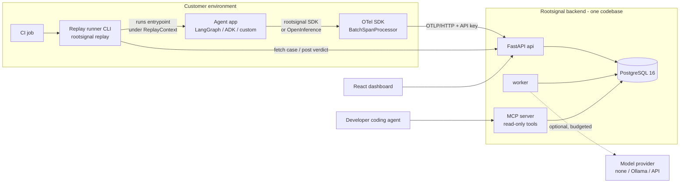
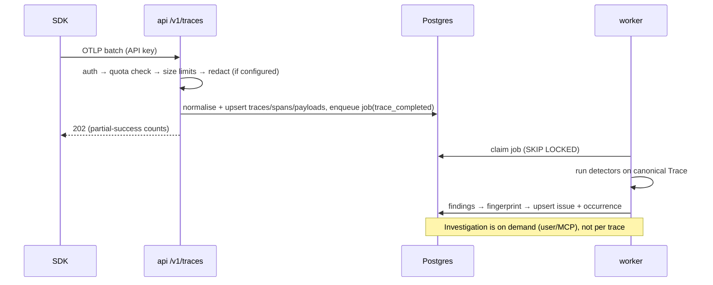
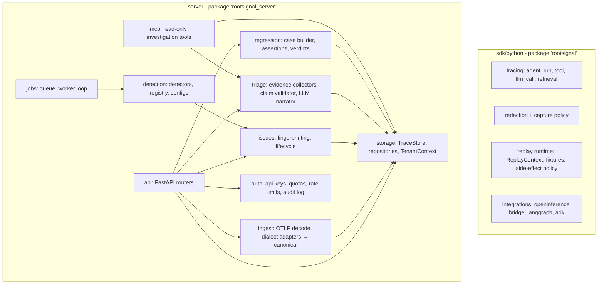

# High-Level Design

Status: Phase 0 draft for review · 2026-10-23 · Depends on: [COMPETITIVE_ANALYSIS.md](COMPETITIVE_ANALYSIS.md)

## 1. Goals and non-goals

**Goal:** a cost-conscious, framework-neutral reliability loop for AI agents: Observe → Detect → Investigate → Reproduce → Fix → Verify. Every AI-generated conclusion must be traceable to evidence, and "verified" must mean a check actually passed.

**Non-goals for Phases 0–1:** semantic signals, ClickHouse, SSO, billing, hosted code execution, broad framework coverage, Kafka/Kubernetes/microservices, Docker (project constraint: native tooling only).

## 2. Architecture decisions

| ID | Decision | Rationale | Revisit when |
|---|---|---|---|
| ADR-001 | **Build a thin platform of our own; reuse standards and instrumentors, not a competitor's backend.** | Phoenix is ELv2 (can't be offered as a SaaS). Langfuse needs ClickHouse+Redis+S3 and gates governance in `ee/`. Workshop is a single-user Bun/SQLite tool whose replay design is the opposite of ours. Our differentiators (detection → issue → regression case → replay verdict) aren't in any of them. | If tracing UX becomes a sink of effort with no differentiation |
| ADR-002 | **No Docker.** Local dev uses Homebrew PostgreSQL 16, `uv` for Python, `npm` for the dashboard, and a `Makefile`/scripts. | Project constraint. Postgres 16 is already running on the dev machine. | Cloud deploy (Phase 3) may use a PaaS buildpack or a plain VM + systemd |
| ADR-003 | **SDK built on the OpenTelemetry Python SDK**, exporting OTLP/HTTP. Attributes follow OTel GenAI semantic conventions; replay/safety metadata goes under a `rootsignal.*` namespace. | Free context propagation, sampling, batching and retry; interoperable with OpenInference/OpenLLMetry auto-instrumentation and other OTLP backends (incl. Workshop), so no lock-in. | If OTel SDK overhead measures above budget (target <1 ms p50 per span on the hot path) |
| ADR-004 | **Ingest accepts OTLP/HTTP (protobuf + JSON) and normalises three attribute dialects** (GenAI semconv, OpenInference, OpenLLMetry) into one canonical schema. | Framework independence lives in ingest normalisation, not in DB tables. | New dialect = new adapter module + fixture tests |
| ADR-005 | **PostgreSQL is the only datastore.** Canonical `traces`/`spans` tables; large payloads in a separate `payloads` table (content-hashed, size-capped), behind a `TraceStore` interface. | One system to operate. ClickHouse only when benchmarks show Postgres query p95 over budget at real volume. | >~50M spans or aggregate query p95 > 2 s |
| ADR-006 | **Postgres-backed job queue** (`jobs` table, `FOR UPDATE SKIP LOCKED`), one worker process. | Durable, transactional with ingest, no Redis. | Sustained >200 jobs/s or a need for fan-out |
| ADR-007 | **One backend codebase, two entrypoints** (`api`, `worker`); module boundaries enforced in code, not by network. | Avoid premature microservices. | Independent scaling needs measured |
| ADR-008 | **Detection is deterministic-first and LLM-free.** Detectors are pure functions `Trace → list[Finding]` with versioned config. | Must work with no LLM provider; precision/recall measurable on fixtures. | Semantic Signals in Phase 2 are an additive, separately budgeted tier |
| ADR-009 | **Investigations are structured claims, not prose.** Each `Claim` has `kind ∈ {observed, hypothesis, alternative, missing_evidence, next_step, verified}` and `evidence_refs` (span/payload/trace IDs). Observed claims come only from deterministic evidence collectors. LLMs may only propose `hypothesis/alternative/next_step`; a validator drops any claim whose refs don't resolve. `verified` is set **only** by a passing regression/replay result. | Directly implements thesis A and prevents "plausible = confirmed". | — |
| ADR-010 | **Pluggable model provider with default `none`.** Providers: `none`, `ollama` (local), `openai_compatible`, `anthropic`. Per-project monthly token/cost budget enforced before each call; payloads go through redaction before leaving the process. | Thesis C; zero recurring cost by default; Ollama is installed locally. | — |
| ADR-011 | **Replay = SDK-level interception, executed by the customer, never by our server.** Tools declare `side_effect ∈ {none, read, write, unknown}`. In replay, model and tool calls resolve from recorded fixtures; `write`/`unknown` tools are never executed (stub + record intent); an unmatched call fails closed (`ReplayDivergence`). The server stores cases and verdicts and re-runs detectors on replay traces. | Never replay side effects; never run untrusted customer code in our infrastructure. | Phase 2: optional customer-hosted runner for `run_approved_replay` |
| ADR-012 | **Tenant scoping from day one:** `org_id` + `project_id` on every tenant row; API keys are scoped to project+environment and stored as hashes; repository functions require a `TenantContext`. Postgres RLS added in Phase 2 as defence in depth. | Retrofitting tenancy is the most expensive fix in SaaS. | — |

## 3. System context



## 4. Core data flow



Trace completion: a trace is considered complete when its root span has ended, or after `trace_idle_timeout` (default 60 s) with no new spans. Detection runs at completion and is idempotent per `(trace_id, detector_version)`.

## 5. Module map



Dependency rule: `sdk` never imports `server`. Inside `server`, domain modules (`detection`, `issues`, `triage`, `regression`) depend on `storage` interfaces and the canonical schema only. FastAPI/HTTP lives in `api` alone. Detectors and the claim validator are pure and unit-testable without a database.

## 6. Repository layout (deviation from the brief, justified)

```
Rootsignal/
  sdk/python/                # pip package `rootsignal` (OTel-based SDK + replay runtime + CLI)
  server/                    # pip package `rootsignal_server` (api + worker + mcp entrypoints)
    src/rootsignal_server/{api,ingest,storage,detection,issues,triage,regression,jobs,auth,mcp}/
    migrations/              # Alembic
    tests/{unit,integration}/
  dashboard/                 # React + TypeScript + Vite
  examples/support_agent/    # synthetic agent with seeded, reproducible failures
  evaluation/datasets/       # labelled traces for detector precision/recall
  scripts/                   # dev bootstrap: createdb, migrate, run api/worker/ui (no Docker)
  docs/
```

Differences from the brief's suggested tree: `core/`, `agents/` and `evaluation/` are merged into one server package because only the server consumes them. Separate top-level packages would add packaging overhead with no isolation benefit while there is one deployable. Framework integrations live in the SDK as optional extras (`rootsignal[langgraph]`), since that's where customers install them. `evaluation/datasets` stays top-level because it's data shared by tests and the validation plan.

## 7. Canonical model (summary; full spec in TRACE_SCHEMA.md, next deliverable)

- `Trace`: `trace_id`, org/project/environment, `agent_name`, `agent_version`, `prompt_version`, `status`, `started_at`, `ended_at`, `source ∈ {production, replay}`, `replay_of_case_id?`, totals (tokens, cost, spans, errors).
- `Span`: `span_id`, `parent_span_id`, `kind ∈ {agent, llm, tool, retrieval, mcp, chain, other}`, `name`, timings, `status`, `error_type/message`, `attempt`, model/provider/tokens/cost, `tool_name`, `side_effect`, `args_hash`, `input_payload_id`, `output_payload_id`, `attributes` (JSONB, bounded).
- `Payload`: content-addressed (`sha256`), `byte_size`, `redaction_state`, `truncated`, body (bounded, default 256 KB; over limit → truncated with marker).
- `Finding` → `Issue` (fingerprint, severity, status, first/last seen, count, affected versions, representative traces) → `Investigation` (claims[]) → `RegressionCase` (input, fixtures, assertions, entrypoint) → `ReplayRun` (trace_id, verdict per assertion, mode).

## 8. Security and cost principles (expanded in THREAT_MODEL.md / COST_MODEL.md)

- All trace content (prompts, tool outputs, retrieved docs, code) is **untrusted data**. The triage LLM receives it inside delimited, labelled evidence blocks with an instruction hierarchy, has no write tools in Phase 1, and its output is schema-validated.
- Capture defaults: model/tool payloads **on**, user request text **off** unless `capture_user_input=True`; regex PII redaction in the SDK before export; server-side redaction hook before storage.
- Quotas per project: spans/day, payload bytes/day, max span payload size, retention days (default 14), LLM tokens/month (default 0 = disabled). Over quota → 429 with `Retry-After`; the SDK drops and counts, never blocks or crashes the host app.
- SDK safe-failure contract: an exporter error, timeout or backend outage must never raise into user code; queue bounded (default 2,048 spans), drop-oldest, self-metrics exposed.

## 9. Known uncertainties

1. **OTel SDK on Python 3.14** (installed locally): compatibility to be confirmed in increment 1; fall back to Python 3.12 via `uv` if needed.
2. **Fixture matching** for repeated calls with identical args (occurrence index) vs. reordered calls after a fix (args-hash lookup): the slice implements both and lets each case choose `strict_order` or `by_args`.
3. **What deterministic replay can verify:** with recorded model outputs, only agent-control-flow and tool-handling fixes are verifiable. Prompt/model fixes need `live_model` mode (Ollama or API), which is non-deterministic. We report the mode alongside every verdict and repeat k times in live mode.
4. **SDK-level interception isn't a sandbox:** a tool that bypasses the wrapper (direct HTTP) isn't stubbed. Mitigation in the slice: in replay the runner installs an outbound-socket guard (allowlist: the Rootsignal API and a local model host). This is documented as a guard, not isolation.
5. **Trace-completion heuristics** for long-running/streaming agents.
