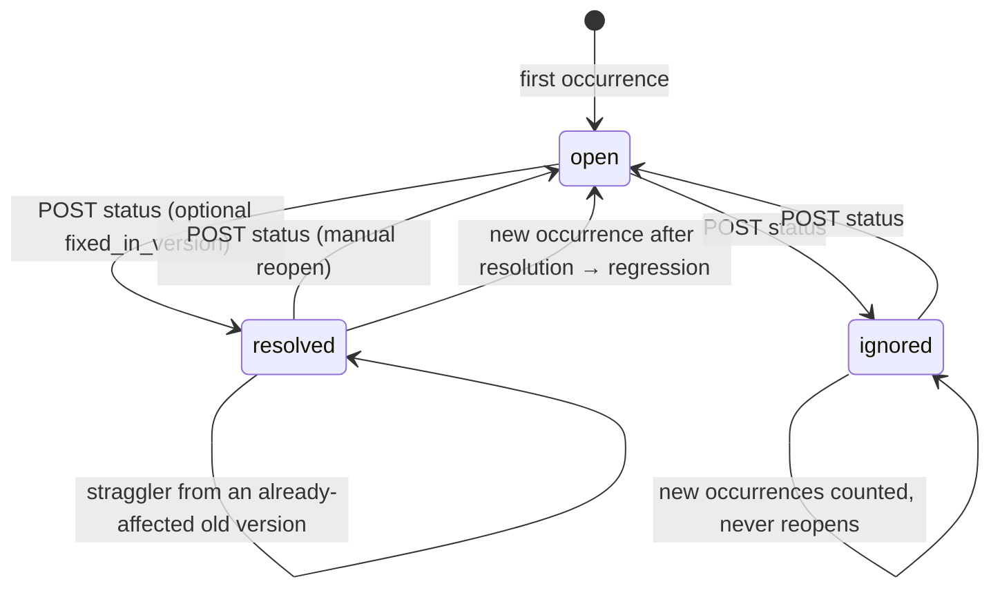

# Issues

Status: implemented in increment 4. Code: `server/src/rootsignal_server/issues/`.

An **issue** groups findings that are the same problem, so 10 runs hitting one bug produce one issue with 10 occurrences, not 10 alerts. Issues are scoped to an environment: the same failure in staging and production gives two issues.

## 1. Fingerprints

A finding's fingerprint is a hash of a per-detector list of components:

| Detector | Default components | Why |
|---|---|---|
| `unhandled_exception` | detector, agent, error type, origin tool | Same crash, same place |
| `tool_error` | detector, agent, tool, error type | Different errors of one tool are different problems |
| `timeout` | detector, agent, subject | Subject = tool, or `llm:<model>` |
| `repeated_tool_call` | detector, agent, tool | **Not** the args hash: different customers' arguments would split one bug |
| `excessive_retries` | detector, agent, subject | |
| `step_limit_reached` | detector, agent | The finding key is a span ID, unique per run |
| `token_budget_exceeded` | detector, agent, subject | Subject = `trace` or `calls` |
| `high_latency` | detector, agent, subject | |

Agent **version** isn't a default component, so one bug spanning v1 and v2 stays one issue, listing both in `affected_versions`. Override per project in `projects.issue_grouping`:

```json
{"tool_error": ["detector", "agent_name", "tool_name"]}
```

Allowed components: `detector`, `agent_name`, `agent_version`, `tool_name`, `error_type`, `subject`. An override must include `detector`; an invalid stored override is logged and the defaults are used. Overrides apply to newly grouped findings. To re-group existing ones, run `rootsignal-server regroup-issues --org <org> --project <project>`; issues left without occurrences keep their history and show a count of 0. Titles are built from the components, e.g. "'get_account' fails with UpstreamError in support-agent", never from a single occurrence's numbers.

## 2. What an issue tracks

- `occurrence_count`: distinct traces.
- `first_seen_at` / `last_seen_at`: the traces' start times.
- `severity`: the highest severity among occurrences.
- `affected_versions`.
- Representative traces: first, latest, and **worst** (highest severity, then most evidence spans, then newest).
- `status`, `is_regression`, `regression_count`, `resolved_at`, `fixed_in_version`.
- History in `issue_events`.

Aggregates are recomputed from `issue_occurrences` on every change rather than incremented. When re-detection removes a finding (e.g. after a config change), its occurrence is deleted and the counts drop.

## 3. Lifecycle



**Regression rule.** A new occurrence reopens a resolved issue (`is_regression = true`, `regression_count + 1`, a `regressed` event) only when **its trace started after `resolved_at`**. Re-detecting an old run is not evidence the fix failed. If the issue was resolved with `fixed_in_version` and the occurrence comes from a different version that was already affected before resolution, it's treated as a straggler from an old deploy still draining. The issue stays resolved, and one `straggler` event is recorded per version. An occurrence from the fixed version, or from a version never seen before, reopens it.

Replay traces (`source = 'replay'`, increment 8) are never grouped into issues: a replay is a test, not a production occurrence.

## 4. Concurrency

Grouping runs inside the detection job's transaction. It takes transaction-scoped advisory locks for every fingerprint involved, in sorted order, so two workers grouping into the same issue serialise (no lost counts) and can't deadlock each other. Status changes lock the issue row; grouping re-reads the status after acquiring its locks.

## 5. History and actors

`issue_events.kind ∈ {created, status_changed, regressed, straggler}`, with `actor` = `system` or `api_key:<prefix>` (the 11-character display prefix, never the key). Status changes can carry a `note`. Investigations (increment 6) will add their own entries.

## 6. Not yet

- Similarity-based grouping across fingerprints (Phase 2).
- Related semantic signals (Phase 2).
- Merging and splitting issues by hand.
- Alerts and notifications.
- Severity overrides.
- Issues for semantic failures (e.g. false success claims), which detectors can't see.
