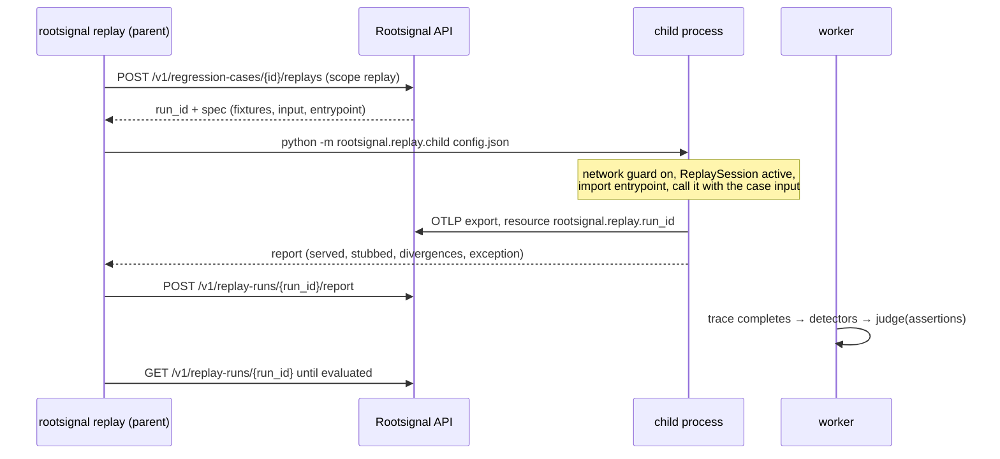

# Replay

Status: v1, implemented in increment 8. Code: `sdk/python/src/rootsignal/replay/` (runner, child process, session, network guard) and `server/src/rootsignal_server/replay/` (runs, verdicts).

Replay runs a [regression case](REGRESSION_CASES.md) against **your current agent code, on your machine**. Tool results and model outputs come from the recording. Rootsignal then judges the replay trace with the same detectors that found the bug. A fix only counts as verified if replay first reproduced the failure on the unfixed code.

## 1. Quick start

```bash
# A key with read + ingest + replay (ingest exports the replay trace)
uv run rootsignal-server create-key --org acme --project support --name replay --scopes read,ingest,replay
export ROOTSIGNAL_API_KEY=rs_…  ROOTSIGNAL_ENDPOINT=http://127.0.0.1:8000

# 1. On the unfixed code: the failure must reproduce
rootsignal replay <case_id> --purpose reproduce --stubs my_agent.replay_stubs
# 2. After the fix: the failure must be gone
rootsignal replay <case_id> --purpose verify --stubs my_agent.replay_stubs
```

The worker must be running, because the verdict waits for detection on the replay trace.

To try it with the bundled example agent (`examples/`, a scripted support agent with a retry-loop bug in v1 and the fix in v2):

```bash
uv run python -m rootsignal_examples.support_agent          # a "production" v1 run → issue
# dashboard: issue → Create from worst trace → copy the case ID
uv run rootsignal replay <case_id> --purpose reproduce --stubs rootsignal_examples.support_agent.replay_stubs
SUPPORT_AGENT_FIX=1 uv run rootsignal replay <case_id> --purpose verify --stubs rootsignal_examples.support_agent.replay_stubs
```

Output, from a run on this machine (2026-10-23):

```
verdict: failing  (case status: reproduced)
  Failure present: 'get_account' is called at most 2 time(s) with identical arguments (at most 4 identical call(s) to 'get_account').
  [FAIL] a1 'get_account' is called at most 2 time(s) with identical arguments (at most 4 identical call(s) to 'get_account')
  [pass] a2 The run still completes (the run's root span ended)
  [pass] a3 No exception escapes the agent run (no exception escaped the run)
  tools served from recording: 4, write/unknown tools stubbed: 0, model outputs served: 4
…
verdict: passing  (case status: passing)
  Failure absent: all 3 evaluated assertion(s) passed.
  tools served from recording: 1, write/unknown tools stubbed: 1, model outputs served: 1
```

## 2. How a replay runs



- The **parent** never imports agent code. The **child** imports the entrypoint (`package.module:function`) and calls it with the case input: keyword arguments for an object, a single positional value otherwise. Async entrypoints are awaited.
- The replay trace is a normal OTLP export marked with the `rootsignal.replay.run_id` resource attribute. The server stores it with `source = replay`. Replay traces never become issue occurrences, and the Traces list hides them unless you pick **Replays** (`GET /v1/traces?source=replay|all`).
- The server finalizes the run when it has both the child's report and the completed trace, whichever arrives last. A trace only counts for a run if it carries that run's ID **and** belongs to the run's project and environment.

## 3. What the agent code sees

Only calls that go through the SDK can be served:

| Call | Recorded mode |
|---|---|
| `@rs.tool` with `side_effect` `none` / `read` | The recorded result, or the recorded error re-raised. The SDK raises the original exception class if it can be found in the tool's module or in builtins, else `RecordedToolError` (with `.error_type`) |
| `@rs.tool` with `write` / `unknown` | **Never executed.** Returns the recorded result if there is one; otherwise the stub registered with `rootsignal.replay.stub(tool, fn)`, else `None`. Each such call is logged in the report |
| `rs.llm_call(...)` + `call.run(fn)` | The recorded model output, in call order; `fn` is not called |
| A model call made without `call.run` | Can't be controlled: reported as `unsupported`, so the verdict is `diverged` |
| A `with rs.tool_call(...)` block whose side effect isn't `none` | Can't be intercepted: stops the run (`unsupported`) |
| Anything the recording can't answer | Stops the run with `ReplayDivergence`: fail closed |

**Matching** (`--match`):
- `by_args` (the default) matches on tool name plus `args_hash`. The k-th identical call gets the k-th recorded result. An identical call made more often than recorded reuses the last result, and the report counts it.
- `strict_order` requires the exact recorded sequence.

`args_hash` must be computed the same way as in production: if you set `ROOTSIGNAL_ARGS_HASH_KEY`, set it for replay too.

`ReplayAbort` (the base class of divergence, unsupported and blocked-network errors) derives from `BaseException`, so the agent's own `except Exception` can't swallow it.

**Options:**
- `--allow-live-reads` runs `read` tools for real when the recording has no answer.
- `--mode live_model` lets the model answer live; add the model host with `--allow-host HOST:PORT`.
- `none` tools without a recording always run live, because they are pure by declaration.

Write stubs live in an ordinary module that you pass with `--stubs`:

```python
# my_agent/replay_stubs.py
from rootsignal.replay import stub
stub("create_ticket", lambda summary, priority: {"ticket": "SUP-REPLAY"})
```

## 4. Verdicts

Each assertion is evaluated only if the replay mode can provide what it `requires` ([REGRESSION_CASES.md §3](REGRESSION_CASES.md#3-assertions)): `recorded` mode evaluates `recorded` assertions, and `live_model` mode evaluates `recorded` and `live_model` ones. Skipped assertions are listed with the reason.

| Verdict | Meaning | CLI exit |
|---|---|---|
| `diverged` | The run left the recording: unmatched call, unsupported call, or blocked network. Nothing is concluded | 2 |
| `inconclusive` | No enabled `reproduces` assertion can be evaluated in this mode, e.g. the failure was a tool timeout, which only live tools can show fixed | 2 |
| `crashed` | The replay itself failed: import error, bad entrypoint, timeout, or no trace | 2 |
| `broken` | A `guard` assertion failed: the code now misbehaves in another way | 1 |
| `failing` | A `reproduces` assertion failed: the failure is present | 0 for `reproduce`, 1 for `verify` |
| `passing` | Every evaluated assertion passed: the failure is absent | 1 for `reproduce`; 0 for `verify` only if the case has reproduced before |

**Case status** after a run:

| Purpose | Verdict | Status |
|---|---|---|
| reproduce | failing | `reproduced` |
| reproduce | passing | `not_reproduced` (the case can't prove a fix yet) |
| verify | passing | `passing`, but only if the case was ever `reproduced`. Otherwise the status doesn't change, and the summary says why |
| verify | failing | `failing` (if it ever reproduced) |
| any | diverged / inconclusive / crashed / broken | unchanged |

Every evaluated run also adds a `replayed` event to the issue's history.

## 5. Safety

Replay runs **your** code, on **your** machine; the server never executes agent code. The safeguards, and what they don't cover, are in [THREAT_MODEL.md §4](THREAT_MODEL.md#4-replay):
- write tools are never executed;
- unmatched calls fail closed;
- an outbound-network guard allows only the Rootsignal API and any `--allow-host`.

The network guard patches Python's `socket.connect` / `connect_ex` in the child process. It catches accidental calls from Python HTTP clients and SDKs. It is **not a sandbox**: native extensions, subprocesses, or code that undoes the patch can bypass it. Don't replay untrusted code.

## 6. API

See [API_SPECIFICATION.md §8](API_SPECIFICATION.md#8-replay-runs). Runs are stored in `replay_runs` (migration `0007`).

## 7. Limits

- Only Python agents, called through an importable function.
- Tool and model calls must go through the SDK (`@rs.tool`, `call.run`). Calls made directly with HTTP clients aren't served; the guard blocks them, and the verdict is `diverged`.
- Failures that depend on live tools (timeouts, tool errors) or on live timing come out `inconclusive` in recorded mode. Live-tool and full-live modes aren't implemented yet.
- `live_model` mode is implemented in the SDK but has only been exercised by unit tests, not against a real model. Increment 10 (the dogfood agent on Ollama) will be its first real use.
- Runs that never report (for example, the CLI is killed) stay in `running`; nothing expires them yet.
