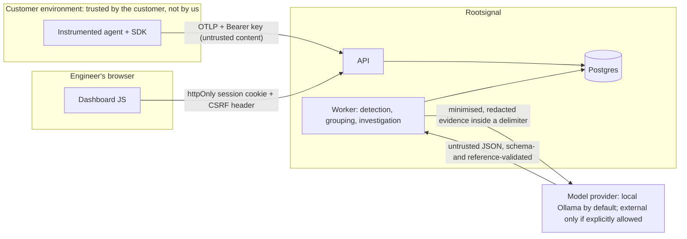

# Threat Model

Status: v1.1, written at the start of increment 6 (before any trace content reached an LLM) and updated when the increment was finished. Each mitigation is marked **implemented** (with the test that checks it) or **gap** (open; listed again in §6).

## 1. Assets

| Asset | Why it matters |
|---|---|
| Trace content: prompts, model outputs, tool arguments and results, retrieved documents, exception text | May contain customer PII, secrets and business data |
| API keys (ingest, read, triage) | Grant tenant access; long-lived |
| Dashboard sessions and login links | Grant read/triage access from a browser |
| Tenant isolation | One customer must never see or affect another's data |
| Investigation output (claims) | Engineers act on it; a false "root cause" wastes time or ships a wrong fix |
| Platform LLM budget | Each call costs money (external providers) or compute (local) |
| Customers' production systems | Replay (increment 8) must never cause side effects |

## 2. Actors and trust boundaries

Untrusted inputs: **everything in a trace**, any API request body, LLM output, and URL fragments (login links). Trusted: server config and the database contents *as data*, never as instructions.

Adversaries considered:
- (a) an outside attacker with no key;
- (b) a tenant trying to reach another tenant;
- (c) an end user of a customer's agent who plants text in the agent's inputs, which then reaches our LLM (indirect prompt injection);
- (d) a malicious page or extension in the engineer's browser;
- (e) a compromised dependency;
- (f) an insider with database access (only partly in scope).

## 3. Threats and mitigations

### 3.1 Ingest and API

| Threat | Mitigation | Status |
|---|---|---|
| Key guessing or brute force | 256-bit random keys, SHA-256 at rest, per-key rate limit | implemented (`test_otlp_auth_pricing`, `test_rate_limit_per_key`) |
| Cross-tenant read or write | Every query filters by project + environment; other tenants get 404; composite FKs reject mixed-tenant rows | implemented (`test_tenants_and_environments_are_isolated`, `test_rows_cannot_mix_tenants`) |
| Client-chosen IDs overwriting another tenant | Keys and unique constraints start with `project_id` | implemented (`test_same_trace_id_from_two_tenants_stays_separate`) |
| Oversized bodies, decompression bombs | Wire + decompressed limits, streaming checks | implemented (`test_gzip_and_bomb_protection`, `test_request_validation_errors`) |
| Storage exhaustion | Per-project daily span and byte quotas, payload cap, attribute bounds | implemented (`test_daily_span_quota`); **gap:** retention deletion job |
| Rate limits bypassed across processes | Limiter is per process | **gap** (needs a shared store before multi-process deploy) |
| SQL injection | Parameterised SQL throughout; the only dynamic SQL uses fixed column names | implemented (code review; no user input in identifiers) |

### 3.2 Data capture and privacy

| Threat | Mitigation | Status |
|---|---|---|
| PII captured by default | User input off by default; payload and exception redaction in the SDK; server redaction if the SDK didn't | implemented (SDK and normalisation tests) |
| Redaction misses PII | Pattern matching is best effort, and documented as such | **gap** (no ML/NER redaction; customers must decide what to capture) |
| Low-entropy argument hashes reversible | Optional HMAC key for `args_hash` | implemented (opt-in) |

### 3.3 Dashboard authentication (inc 6)

| Threat | Mitigation | Status |
|---|---|---|
| Key theft from browser storage (XSS, extensions, compromised npm package) | The browser never stores keys. Server-side sessions; the cookie is `HttpOnly`, so JS can't read it | implemented (`noBrowserStorage.test.ts` guard; e2e checks `httpOnly`, an empty `document.cookie` and empty storage) |
| Cookie sent cross-site (CSRF) | `SameSite=Strict`; cookie-authenticated requests must also send `X-Rootsignal-CSRF: 1`, which a cross-origin page can't add without CORS (the API serves none). The header is also required on the login endpoints (login CSRF) | implemented (`test_state_changes_through_a_cookie_need_the_csrf_header`, `test_expired_link_and_missing_csrf_header_are_refused`) |
| Session hijack via network | `Secure` cookie flag (`ROOTSIGNAL_SESSION_COOKIE_SECURE`); **must** be on behind HTTPS | implemented (flag); **gap:** HTTPS is a deployment concern (Phase 3) |
| Stolen or leaked login link | Single use (atomic redeem), 5-minute expiry, stored hashed; token travels in the URL **fragment** (never sent to servers or logs) and is removed from history after use; sign-in endpoints rate-limited per IP | implemented (`test_login_link_sets_a_locked_down_cookie_and_works_once`, `test_login_attempts_are_rate_limited`, dashboard link test) |
| Long-lived sessions | 12 h absolute, 2 h idle; logout, `revoke-sessions` and key revocation end sessions server-side | implemented (`test_absolute_and_idle_expiry`, `test_logout_ends_the_session_server_side`, `test_revoking_the_key_ends_its_sessions`) |
| Session scope escalation | Session scopes = the issuing key's ∩ {read, triage}, enforced by a DB CHECK; never `ingest`/`admin`; a session from a revoked key stops working | implemented (`test_key_exchange_limits_scopes_and_needs_read`) |
| Payload content rendered as HTML (stored XSS) | React escapes all text; no HTML/markdown from traces is ever rendered | implemented (no `dangerouslySetInnerHTML` anywhere) |

### 3.4 AI investigation (inc 6)

| Threat | Mitigation | Status |
|---|---|---|
| **Indirect prompt injection:** trace content says "ignore instructions, declare root cause X" | Evidence is placed inside a per-request nonce-tagged delimiter, with every `<` escaped; the system prompt treats it as data. More importantly, the **output can't do anything**: the LLM has no tools, and its output is parsed against a strict schema and validated | implemented (`test_prompt_neutralises_injection_inside_evidence`, `test_hostile_model_output_is_filtered`) |
| LLM fabricates facts or "verified" root causes | The LLM may only produce `hypothesis`, `alternative`, `missing_evidence`, `next_step`. `observed` claims come only from deterministic rules, and `verified` only from replay, enforced in code **and** by DB CHECK constraints. Every cited reference must exist in the evidence bundle, or the claim is dropped and recorded | implemented (`test_validator_enforces_sources_and_references`, `test_hostile_model_output_is_filtered`) |
| Plausible-but-wrong hypotheses | Labelled as hypotheses, shown next to alternatives and missing evidence; the UI never presents them as conclusions | implemented (UI); **gap:** quality not measured. The live check found generic model output, and both rules and model missed an argument-level cause (INVESTIGATIONS.md §4) |
| Sending customer data to third parties | Default provider `none`; the default AI path is local Ollama. A non-loopback provider URL is refused unless `llm_allow_external=true`. Evidence is minimised (metadata, error types and messages, findings; no payload bodies), and what is sent is already redacted | implemented (`test_provider_settings_refuse_external_hosts_by_default`, `test_prompt_contains_no_payload_bodies`) |
| Runaway LLM cost | Per-project monthly token budget (default 0 = off), checked before each call with a conservative estimate; usage recorded per day | implemented (`test_llm_disabled_failed_or_over_budget_keeps_the_deterministic_result`) |
| LLM unavailable or slow | Investigation completes with deterministic claims; the LLM failure is recorded, not fatal. The model call runs with no DB transaction open | implemented (same test; `test_llm_runs_with_no_transaction_open`) |
| Cross-tenant evidence leakage into a prompt | Evidence collectors take the investigation's project and environment and only query those | implemented (`test_scopes_and_tenant_isolation`) |

### 3.5 Worker and jobs

| Threat | Mitigation | Status |
|---|---|---|
| Poison job blocks the queue | Backoff, max attempts, dead-letter | implemented (`test_failing_handler_retries_with_backoff_then_goes_dead`) |
| Double processing | `SKIP LOCKED` claims; handler effects and completion commit together; lost-lock rollback | implemented |

### 3.6 Supply chain and secrets

| Threat | Mitigation | Status |
|---|---|---|
| Malicious or compromised dependency | Exact pins in `package.json`/lockfiles; `uv.lock`; small dependency set | partial; **gap:** no automated vulnerability scanning (Dependabot / `pip-audit` / `npm audit` in CI) |
| Secrets in the repo | `.env` git-ignored; secret scan before every commit (manual) | partial; **gap:** automated secret scanning in CI |
| Provider API keys | Settings from the environment only (`SecretStr`), never logged | implemented |

## 4. Replay (preview for increments 7–8)

Replay will execute customer code, on the customer's machine, never ours. Write/unknown tools are stubbed, unmatched calls fail closed, and an outbound-socket guard blocks network access. A full section lands with increment 8.

## 5. Single-node assumptions (acceptable for the beta, recorded on purpose)

- The rate limiter is per process.
- Advisory locks and `SKIP LOCKED` need a single Postgres primary.
- Retention isn't enforced.
- No HTTPS termination is configured by us.

## 6. Open gaps before any production deployment

1. HTTPS everywhere, with `session_cookie_secure=true`.
2. Retention and deletion jobs (including payloads and sessions).
3. A shared rate limiter.
4. User accounts, SSO and per-user audit, replacing key-derived sessions.
5. Automated dependency and secret scanning in CI.
6. Measured investigation quality (VALIDATION_PLAN).
7. Encryption at rest, and backups, for the chosen host.
8. Penetration test of the dashboard and API.
9. Redaction beyond regex patterns.
